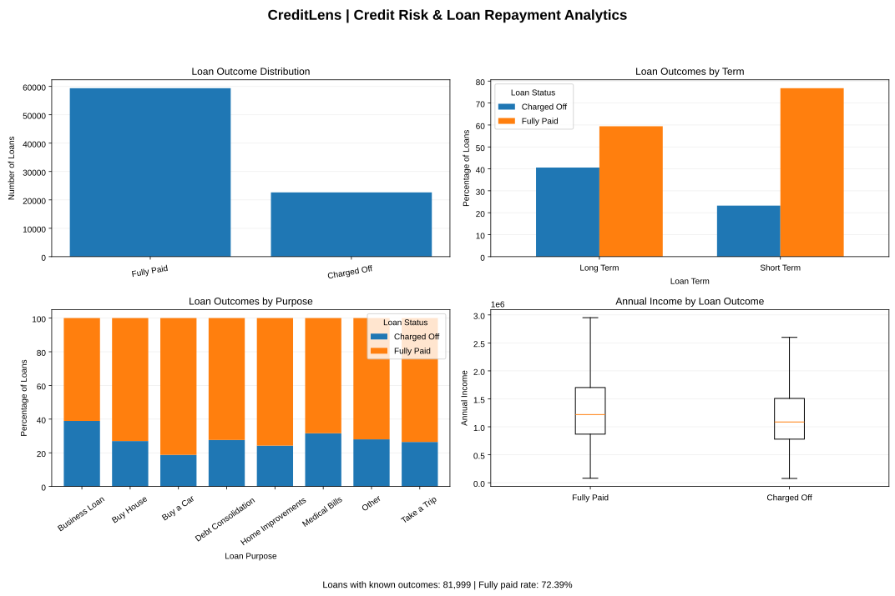
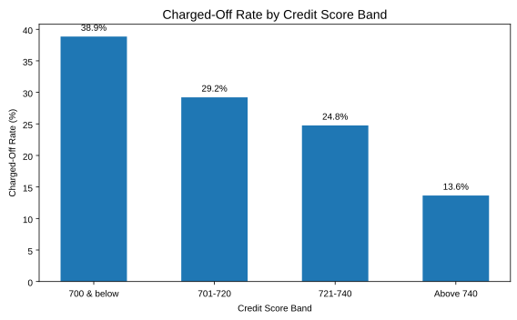

# CreditLens: Credit Risk & Loan Repayment Analytics

End-to-end credit risk analysis of **~100,000 bank loan records** in Python, identifying which borrowers and loan types are most likely to default (be *charged off*) and turning the findings into lending recommendations.

## 🎯 Business Problem
A lender wants to reduce loan defaults. Which loan terms, purposes and borrower profiles carry the highest risk, and how should approval and pricing rules change?

## 🛠️ Tools
Python · Pandas · NumPy · Matplotlib · Jupyter Notebook

## 📂 Dataset
Public bank loan dataset (Kaggle): 100,514 rows × 19 columns, including loan amount, term, purpose, credit score, annual income, monthly debt and credit history.

## 🧹 Data Cleaning
- Removed **514 blank rows** and **10,215 exact duplicate records**
- Resolved **7,786 repeated loan IDs** by keeping the most complete record for each loan
- Found and corrected **4,551 credit scores stored ×10** (e.g. 7,250 → 725). Every affected record was a charged-off loan, so leaving them uncorrected would have made credit score look like a perfect predictor of default
- Treated **11,484 placeholder loan amounts** (99,999,999) as missing
- Standardized inconsistent categories (`other` → `Other`, `HaveMortgage` → `Home Mortgage`)
- Final clean dataset: **81,999 unique loans**

## 📈 Key Insights
| Finding | Result |
|---|---|
| Overall charged-off rate | **27.6%** |
| Long-term vs short-term loans | **40.6%** vs **23.3%** default rate |
| Credit score 700 & below vs above 740 | **38.9%** vs **13.6%** default rate |
| Riskiest purposes | Small business (**51.7%**), Business loan (**38.9%**) |
| Safest purpose | Buy a car (**18.8%**) |
| Median income: defaulted vs repaid | **10.9% lower** for defaulted borrowers |
| Median estimated debt-to-income | **18.5%** (defaulted) vs **16.2%** (repaid) |

## 💡 Business Recommendations
1. **Tighten approval for long-term loans**, which default almost twice as often as short-term loans.
2. **Price loans by credit score band**: borrowers scoring 700 and below default nearly 3× as often as those above 740.
3. **Review small-business and business lending policy**, where 4 to 5 in 10 loans are charged off.
4. **Add data validation at entry** so out-of-range credit scores and placeholder amounts are flagged.

## 📊 Analysis Covered
Loan outcome distribution · Credit score distribution and score bands · Annual income · Loan term · Loan purpose · Debt-to-income ratio · Credit history length · KPI summary · 4-panel Python dashboard

## 📁 Files
| File | Description |
|---|---|
| `main.ipynb` | Full analysis notebook with outputs |
| `credit_train.csv` / `credit_test.csv` | Raw data |
| `credit_train_cleaned.csv` / `credit_test_cleaned.csv` | Cleaned data |

## 👤 Author
**Davis Wilson**, Data Analyst · [LinkedIn](https://www.linkedin.com/in/datawithdavis) · [GitHub](https://github.com/DataWithDavis)
